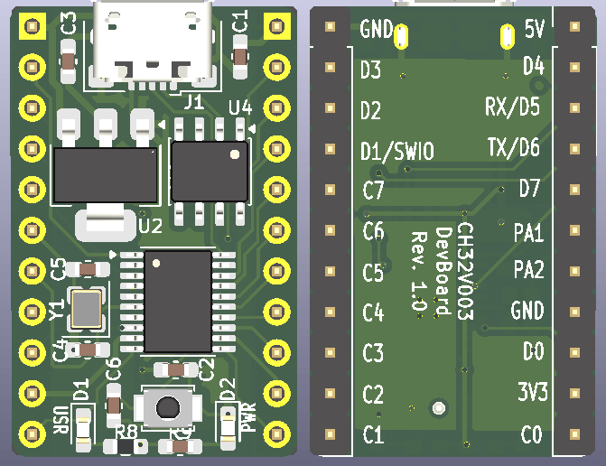
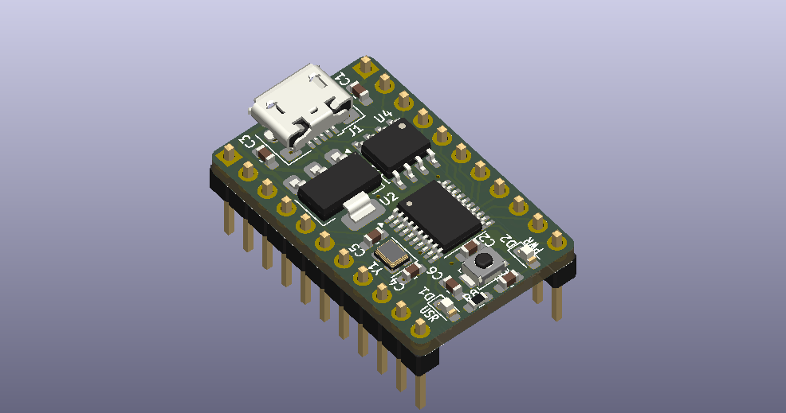

# CH32V003-DevBoard

## Description

This is a CH32V003 dev board (Prototype Stage).

It features:
* Micro USB connector
* Optional Crystal
* User Button at PD7 (also for Reset)
* User LED at PC0
* USB CH340 Serial chip

## Images

